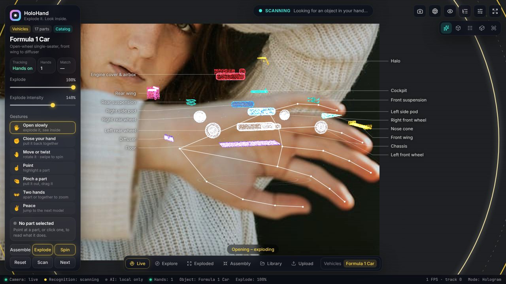
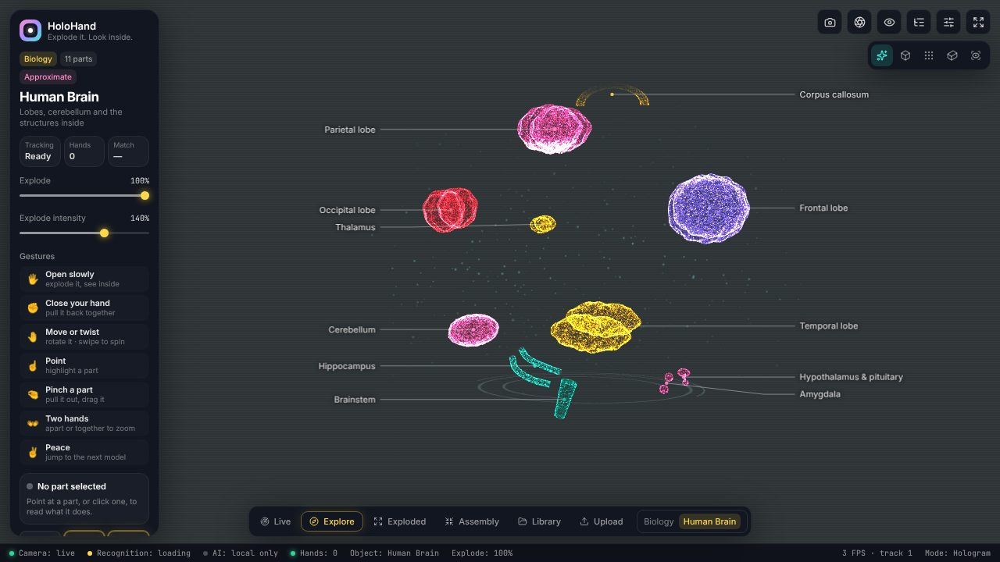
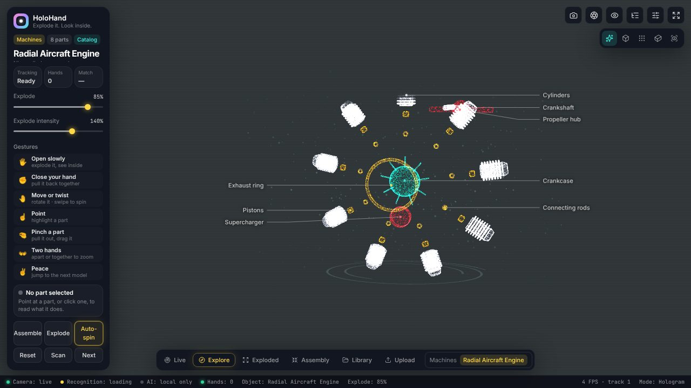
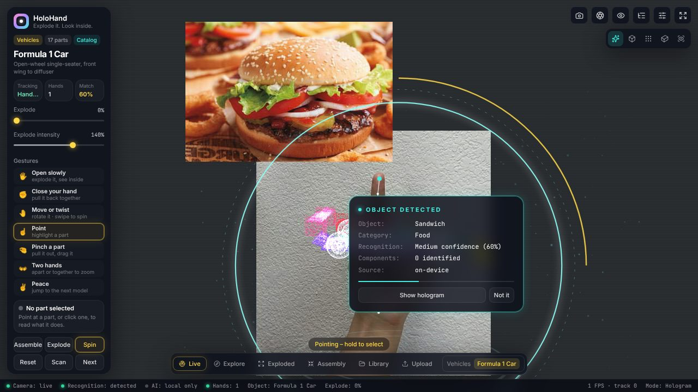

# HoloHand AI

**Hold an object up to your webcam → it's recognised → a holographic 3D model appears over the live feed → open your hand to explode it into labelled components.**



| | |
|---|---|
|  |  |
|  | |

All screenshots come from the real app running in headless Chromium, with a fake webcam fed from real hand photos. Rendering there is software-only, so FPS in the status bar is low; on a normal laptop GPU it runs at full frame rate.

---

## Quick start

```bash
npm install
```

```bash
npm run setup:assets
```

```bash
npm run dev
```

Then open <http://localhost:5173> and allow camera access.

- `npm install` also copies the MediaPipe WASM runtime into `public/mediapipe/`.
- `npm run setup:assets` downloads the three on-device models (hand landmarker, EfficientDet-Lite0 object detector, EfficientNet-Lite0 classifier, about 33 MB) into `public/models/mediapipe/` so the app works offline. If you skip it, the models load from Google's CDN at runtime.
- `npm run dev` starts Vite on :5173 and the API server on :8787. Vite proxies `/api`.

No API key is needed. Optional cloud AI is described below.

Production:

```bash
npm run build
```

```bash
npm start
```

`npm start` serves `dist/` and the API on one port (8787 by default).

Requirements: Node 20+, a WebGL2 browser (Chrome/Edge/Firefox/Safari), and `localhost` or HTTPS (browsers only allow camera access there).

---

## What works locally, and what needs a provider

| Feature | Local (no key) | With a cloud/local AI provider |
|---|---|---|
| Webcam, camera selection, permission handling | ✅ | ✅ |
| Two-hand tracking (MediaPipe Hand Landmarker) + all gestures | ✅ | ✅ |
| Object detection near the hand (80 COCO classes) + crop classification (1000 ImageNet classes) | ✅ on-device | ✅ used as hints |
| Object name & category | ✅ from on-device labels | ✅ richer, e.g. "Toy Formula 1 car" |
| Brand / exact model | ❌ never guessed locally | ✅ only when visibly identifiable |
| Component list | typical parts of the matched template, flagged as typical | ✅ object-specific, with confidence |
| Level 1 catalog models (bundled F1 car, radial engine, brain) | ✅ | ✅ |
| Level 2 procedural approximations (20 templates) | ✅ | ✅ + component mapping |
| Level 2 AI primitive approximation for *any* object | ❌ | ✅ |
| Level 3 recognition-only fallback | ✅ | ✅ |
| Upload GLB/GLTF, explode by mesh | ✅ | ✅ + "Describe meshes with AI" |
| Photo upload, manual search, library/history (IndexedDB) | ✅ | ✅ + "Ask AI" text lookup |

### Configuring a provider

Copy `.env.example` to `.env` and set **one** of the following:

```bash
GEMINI_API_KEY=...           # Gemini (default model gemini-3.5-flash, thinking=low)
ANTHROPIC_API_KEY=...        # Claude (default model claude-opus-5-5, effort=low)
OPENAI_API_KEY=...           # or any OpenAI-compatible endpoint via OPENAI_BASE_URL
AI_PROVIDER=ollama           # free & local, e.g. `ollama pull llava` / `qwen2.5vl`
```

If several keys are set, `AI_PROVIDER` picks one; otherwise the first provider with a key is used. Keys are read only by the Node server and never reach the browser.

- **Gemini:** each attempt has a timeout, and on failure the server falls back through `GEMINI_FALLBACK_MODELS` (default `gemini-3.5-flash,gemini-3.1-flash-lite,gemini-flash-latest`). A model that returns 429 is cooled down for the `retryDelay` the API asks for. `GEMINI_THINKING` sets the thinking level (`low` is about 3× faster than the default).
- **Anthropic:** uses the server-side refusal fallback (`fallbacks: "default"`). `ANTHROPIC_EFFORT` trades latency for depth.

**Privacy:** hand tracking and on-device recognition run in the browser. With a provider configured, a JPEG of the region around your hand (up to 1024 px, or the whole frame if no hand is found) is sent while scanning, at most every 4 s and rate-limited per client (`AI_REQUESTS_PER_MINUTE`). Without a provider, nothing leaves the browser. Error messages shown in the UI are neutral; provider details stay in the server log.

---

## Using it

### Gestures

| Gesture | Action |
|---|---|
| 🖐️ **Open hand slowly** | Explode. Openness sets how far it separates. |
| ✊ **Close your hand** | From open: pull the parts back together. A fist that was never open is ignored, so gripping an object does not move anything. |
| 🤚 **Move / twist** | Hologram follows your palm (height and position). Twisting your hand rotates it. |
| 👋 **Swipe** left/right (up/down) | Spin (tilt) with inertia |
| ☝️ **Point** | Aim at a part (the model stops moving while you aim). Hold ~0.7 s to lock onto it: the hologram then stays put, even if you move or drop your hand, until you point at another part. |
| ✊ **Hold a fist** (with a part locked) | Let go of the part |
| 🤏 **Pinch** | On a part: grab it and drag it out. On empty space: rotate the model. |
| 👐 **Two open hands** | Move apart or together to zoom (dashed line shows the ratio) |
| 👍 **Thumbs up** (hold) | Next model |
| 🤘 **Rock sign** (hold ~0.6 s, either hand) | Clear the screen and scan again. Removes the hologram, labels, panels and controls; they return once a scan locks. |

Gestures are debounced (a pose must hold for about 110 ms) and mutually exclusive: one active gesture at a time, with a priority order. Landmarks are exponentially smoothed. In **Settings** you can toggle each gesture, tune sensitivity and smoothing, switch hand-following on or off, and run a **calibration** (open hand, then fist) that personalises the openness thresholds.

### Mouse & keyboard

- Drag to rotate. Wheel to zoom.
- **Shift+wheel** or **right-drag** explodes.
- Click a part to select it. Double-click to zoom into it. **Shift+drag** pulls a part out.
- Keys: `E` toggle explode, `A` assemble, `R` reset view, `N` next model, `L` live scan, `C` clear the screen, `1–5` render modes, `Esc` clear selection.

### Modes

- **Live:** clears the hologram, then camera + continuous recognition. The app starts here with nothing on screen.
- **Explore:** recognition paused.
- **Exploded / Assembly:** animate to 100 % / 0 %.
- **Library:** catalog, templates, your uploads, recognition history.
- **Upload:** manual model mode for GLB/GLTF files.

### Render modes

Hologram (point cloud + fresnel shell + glowing edges), Wireframe, Point cloud, Solid, and X-ray (fresnel shells, so inner parts show through). Modes crossfade.

---

## How recognition works

```
webcam ──► MediaPipe Hand Landmarker (every frame, adaptive) ──► gestures
   │
   └─► every ~650 ms (own timer, never blocks rendering):
        EfficientDet-Lite0 → boxes; pick the one touching the hand (else: region around the hand)
        EfficientNet-Lite0 on that crop → ImageNet labels
        knowledge resolver → template match

   no provider:   7-frame vote, needs 4 agreeing ──► LOCK
   with provider: no vote; every ~4 s POST /api/recognize
                  (wide crop around the hand + local hints → zod-validated JSON,
                   open-vocabulary name, holdingObject, primitive 3D model)
                  holdingObject = false → keep scanning
                  request fails → keep scanning (no weak local guess)
                                               │
        confidence < threshold?  → "Is this a …?" confirm card   else → OBJECT DETECTED card
                                               │
        model resolution:
          Level 1  catalog GLB (local catalog.json + MODEL_CATALOG_URLS)
          Level 2  procedural template  |  AI primitive layout      (badged APPROXIMATE)
          Level 3  recognition only (info panel, no geometry)
        component mapping: recognised parts ↔ mesh names (synonyms, greedy matching);
          unmatched parts are listed as "identified but not modelled"
```

Honesty rules built into the pipeline:

- Brand and model stay `null` unless a provider sees them.
- Local results say their components are *typical*.
- Hidden internals get low confidence and a note.
- Approximate models carry a disclaimer.
- Every component shows its source and an identification-confidence bar.

A bare hand doesn't lock as an object. Locally, crops taken around a hand only count through a template match; with a provider, the AI reports an empty hand. To save requests, hands that are pointing or making the rock sign are skipped, and a scene the AI already called empty is rechecked only after 20 s.

---

## The 3D model format

Any GLB/GLTF works: each top-level node or mesh becomes a component, and explosion vectors are computed radially from the centre. For full control, put a `holo` object in a node's glTF **extras**:

```jsonc
{
  "holo": {
    "id": "front-wing",
    "name": "Front wing",
    "parentId": "front",                // a group or another part
    "description": "Multi-element wing …",
    "function": "Front downforce",
    "location": "Very front",
    "technical": { "Elements": "Main plane + flaps" },
    "explodeDirection": [1, -0.1, 0],   // model space
    "explodeDistance": 0.7,             // × model radius at 100 %
    "explodeMode": "linear",            // or "radial": children fly outward individually
    "confidence": 1,
    "source": "catalog",
    "color": "#ffd84a"
  }
}
```

Virtual groups (sub-assemblies with no geometry) go in `holoGroups` on the root node. The explosion engine adds each ancestor's displacement to its children, so the halo rides out with the cockpit and the front wheels move with the front assembly while also moving outward.

The bundled samples are baked by `npm run gen:models` (`scripts/generate-sample-models.ts`) from the procedural definitions. They are **illustrative test assets**: separately named meshes and simplified geometry, not measured reconstructions. The UI says so.

### Extending the knowledge base

- **New template:** add an `Archetype` in `src/three/models/procedural/*.ts` (keywords, `build()` with the `AssemblyBuilder` DSL) and register it in `index.ts`. Recognition, search, library and the playlist pick it up automatically.
- **New catalog models:** add GLBs plus entries to `public/models/catalog.json`, or host a catalog anywhere and list it in `MODEL_CATALOG_URLS`. Each entry needs `license` and `attribution`; entries without them are rejected and attribution is shown in the UI.
- **New AI provider:** implement `VisionProvider.json()` in `server/providers/` and add it to `createProvider()`.

---

## Project structure

```
src/
  components/   Sidebar, Camera (feed, top controls, fallback), Hologram (canvas, labels),
                GestureControls (hand overlay), ComponentExplorer, ObjectInfo, Settings,
                Library (catalog/templates/uploads/history, upload), Scan (photo, search,
                recognition overlays), StatusBar (status, mode bar, toasts)
  vision/       handTracking (MediaPipe loop), gestureRecognition (pure analyzer + engine),
                objectDetection (detector + classifier), mediapipe.ts (shared WASM, asset fallback)
  ai/           knowledge (label → template resolver), componentAnalysis (mapping)
  three/        models (prepare/normalise, procedural templates, AI primitives), explosion,
                shaders (point cloud, fresnel, edges), effects, interactions, scene (render layers)
  services/     camera, model (pipeline + catalog), recognition, storage (IndexedDB), actions
  hooks/ state/ types/ utils/ styles/
server/
  api/          /api/health, /api/catalog, /api/recognize, /api/describe, /api/describe-meshes
  providers/    anthropic (official SDK), openai(-compatible), gemini, ollama
  recognition/  zod schema (also the structured-output schema), prompts
  services/     remote catalogs, rate limiting
scripts/        setup-assets.mjs, generate-sample-models.ts
tests/          unit + API tests (fixtures are real MediaPipe landmarks)
```

---

## Testing

```bash
npm test
```

```bash
npm run typecheck
```

`npm test` runs the unit and API tests:

- Gesture classification on **real MediaPipe landmarks**, captured from photos of an open hand, fist, peace sign, pointing and thumbs-up.
- Gesture engine behaviour: debounce, dwell select, two-hand zoom, swipe, disabled gestures.
- Explosion maths: per-part vectors, hierarchy inheritance, monotonicity, exact reassembly, radial parts.
- Every template builds.
- Label→template resolution, catalog search, component mapping, AI primitives.
- The API end to end against a stub OpenAI-compatible upstream, plus remote catalogs.

Manual and end-to-end checks used during development: Chromium with `--use-file-for-fake-video-capture` playing real hand photos. These checks confirmed:

- the webcam opens
- 1 and 2 hands are tracked
- open hand explodes to 100 % and fist reassembles
- thumbs up, point and two-hands are recognised
- photo upload reaches the Level 3 path
- a held object is detected and locked live
- the slider explodes, labels follow their meshes, selection, isolate, every render mode, next model, library, and GLB upload work
- no console errors

---

## Limitations (read this)

- **On-device recognition covers 80 COCO + 1000 ImageNet classes.** Anything outside those (most toys, niche gadgets) gets a vague or wrong local label. Use the confirm card, manual search, or a provider. A toy F1 car usually classifies as "race car" or "sports car" and maps to the F1 or sports-car template, but this depends on angle and lighting.
- **Procedural templates are generic.** A recognised phone shows *a* phone, not *your* phone. They're badged APPROXIMATE and their internals have low confidence.
- **AI primitive models are rough box/cylinder layouts.** Their quality depends on the provider.
- **Provider testing:** Gemini is the provider used day to day during development. The Anthropic and Ollama providers type-check and follow the documented request formats but have had much less real-world use. The automated tests cover the OpenAI-compatible path against a local stub, not the real OpenAI service.
- **Rendering:** the glow comes from additive point sprites and fresnel shaders rather than a separate bloom post-processing pass (that pass is costly on transparent canvases over video).
- **External catalogs:** there is a generic JSON-catalog integration. Marketplace APIs such as Sketchfab are not built in, because they need OAuth tokens and per-model licence handling. The provider interface is the place to add them.
- **Uploads:** `.gltf` files must embed their resources. Draco- and Meshopt-compressed files are not supported.
- **Hand tracking needs light:** gesture quality depends on lighting and on the hand being fully in frame. Use calibration if openness feels off.
